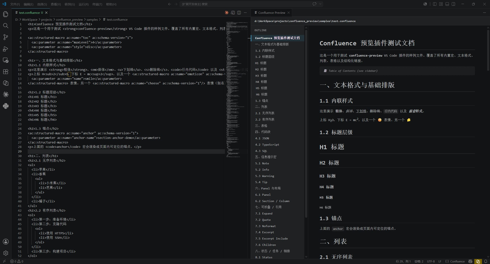
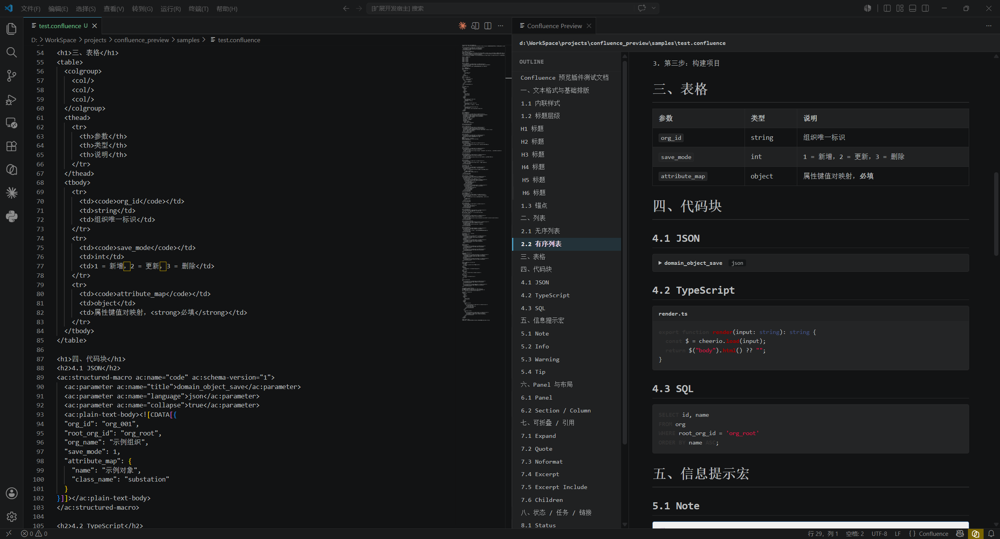
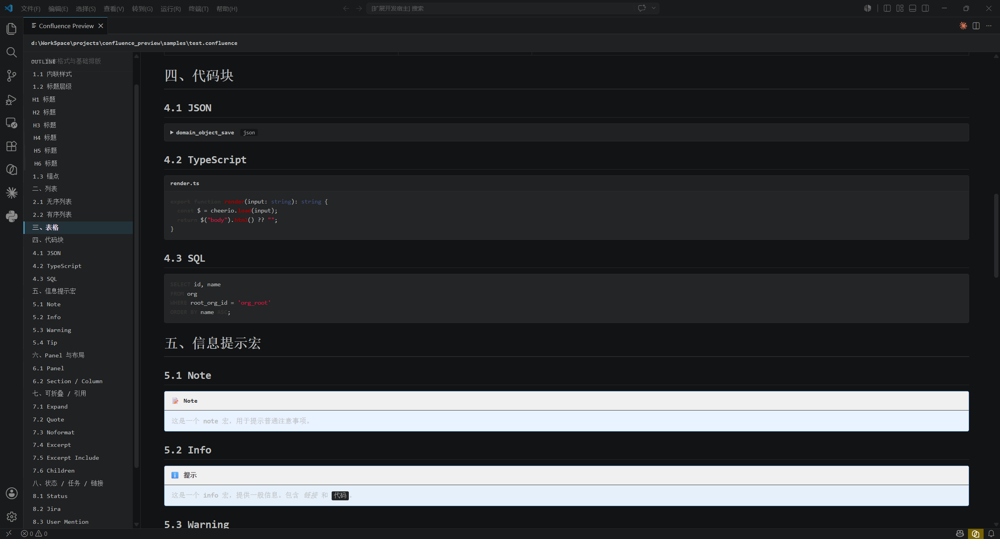
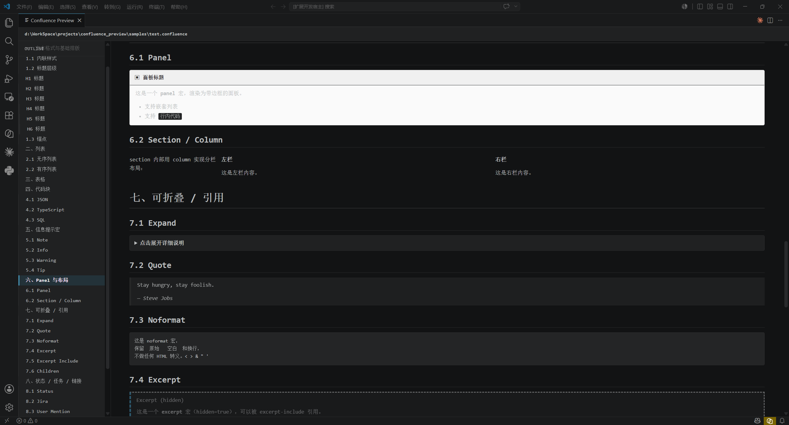
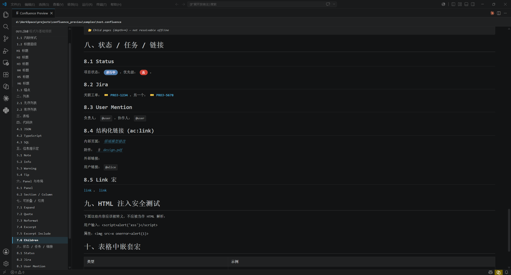

<div align="right">

**[简体中文](./README.md)**

</div>

<div align="center">

<p align="center">
  
</p>

# Confluence Preview

Preview Confluence Storage Format (XHTML) inside VS Code.

[Features](#features) · [Quick start](#quick-start) · [Commands](#commands) · [Settings](#settings) · [Supported elements](#supported-elements) · [FAQ](#faq)

[](./LICENSE)
[](https://code.visualstudio.com/)
[](https://www.typescriptlang.org/)
[](#why)
[]()
[](https://github.com/uwakeme/confluence_preview/actions/workflows/ci.yml)

A fully client-side VS Code extension. Open a `.confluence` file and the rendered page sits next to the source, refreshing on every keystroke. No Confluence connection, no network calls, no telemetry.


Source on the left, outline and rendered page on the right.

</div>

---

## Why

Writing in Confluence's Source Editor means staring at a wall of `<ac:structured-macro>` tags. To see the result, you paste it back into Confluence, hit Preview, squint, go fix something, and repeat. This extension skips that loop. Open the file in VS Code and the rendered page shows up beside the source, refreshing as you type. No publishing, no round-trips.

The parser runs entirely on your machine, so it works on planes, in subways, and inside air-gapped networks.

---

## Features

| | |
|---|---|
| **Side-by-side preview**: rendered page appears beside the editor, auto-refreshes on edit or save, and keeps your reading position and expanded sections across refreshes. | **Live outline sidebar**: every `h1`–`h6` is collected into a clickable, collapsible tree that tracks the scroll position; hide it anytime from the preview header. |
| **Full macro support**: `code`, `toc`, `panel`, `note` / `info` / `warning` / `tip`, `expand`, `status`, `jira`, `user-mention`, `link` / `pagelink`, `section` / `column`, `excerpt` / `excerpt-include`, `quote`, `noformat`, `anchor`, `children`, `emoticon` / `cheese`. Unknown macros fall back to a muted box and raise a warning. | **Syntax-highlighted code blocks**: JSON, TypeScript, SQL, anything `highlight.js` knows about, themed to match VS Code, with line numbers and a configurable first line. |
| **Images and attachments**: `ac:image` attachments and relative `` paths resolve to files next to the source, with dimensions, borders and captions; local attachment links open on click. | **Modern Cloud formats**: `ac:layout` page layouts (equal / sidebar / three-column), `ac:task-list` checklists, colored text, table cell highlights. |
| **Structured-link resolution**: `<ac:link>` with `ri:page` / `ri:attachment` / `ri:url` / `ri:user` render as proper inline links with custom link text; set a Confluence base URL and internal page links become real links. | **Theme-aware**: adapts to VS Code's light, dark, and high-contrast themes. |
| **Two-way navigation**: scrolling the editor moves the preview to the matching section; double-clicking a preview heading jumps back to the source. | **Export anywhere**: copy the rendered HTML, save as Markdown, or export a standalone HTML file with styles and highlighting inlined (opens in any browser, follows the system light/dark theme). |
| **XSS-safe by default**: every user-supplied string is escaped, style parameters pass an allowlist, and `javascript:` links are neutralized. | **Window restore**: the preview survives a VS Code window reload — no need to reopen it. |

### Macro showcase

| | |
|---|---|
| **Code blocks and tables**: collapsible panels, line numbers, JSON / TS / SQL highlighting.<br><br> | **Color-coded callouts**: `note`, `info`, `warning`, `tip`.<br><br> |
| **Layout and folding**: `panel`, `section` / `column`, `expand`, `quote`, `noformat`, `excerpt`.<br><br> | **Status, jira, mentions, links, XSS test**: colored pills, ticket links, @mentions, page / attachment / user / URL links, escaped HTML.<br><br> |

---

## Quick start

> About two minutes from clone to preview.

1. **Install and build**
   ```sh
   npm install
   npm run build
   ```
2. **Launch the extension**: open this folder in VS Code and press F5. A new Extension Development Host window opens.
3. **Open a sample**: in the new window, open `tests/test.confluence` (covers every supported macro and modern format), then press `Ctrl+Shift+V` (`Cmd+Shift+V` on macOS), or `Ctrl+Shift+P` → `Confluence: Open Preview`.

Edit on the left, preview on the right.

---

## File types

These filename patterns are registered as the `confluence` language:

- `*.confluence`
- `*.cfl`
- `*.confluence-storage`

Plain `.html` files are left alone by default; turn on `confluence-previewer.enableForHtml` to preview them without renaming.

---

## Commands

| Command | What it does |
|---|---|
| `Confluence: Open Preview` | Opens or focuses the preview pane beside the active editor (`Ctrl+Shift+V` / `Cmd+Shift+V`) |
| `Confluence: Refresh Preview` | Forces an immediate re-render (Command Palette, or the editor title button while a preview is open) |
| `Confluence: Copy Rendered HTML` | Copies the rendered HTML to the clipboard |
| `Confluence: Export to Markdown` | Saves the document as GFM-flavored Markdown |
| `Confluence: Export Standalone HTML` | Saves a single HTML file with styles and highlighting inlined — opens offline in any browser |

---

## Settings

| Setting | Default | What it does |
|---|---|---|
| `confluence-previewer.baseUrl` | `""` | Confluence base URL. When set, internal page links with a space key resolve to real `/display/SPACE/Title` URLs |
| `confluence-previewer.jiraBaseUrl` | `""` | Jira base URL, used by `jira` macros without a `baseurl` parameter to turn issue keys into real links |
| `confluence-previewer.localFiles` | `true` | Resolve attachment links, `ac:image` and relative `` paths against files next to the source document |
| `confluence-previewer.refreshDebounce` | `250` | Delay in milliseconds before the preview refreshes while typing |
| `confluence-previewer.outlineVisible` | `true` | Show the outline sidebar when the preview opens (the header toggle wins afterwards, and your choice is remembered) |
| `confluence-previewer.enableForHtml` | `false` | Also offer the preview for plain `.html` files |

---

## Supported elements

### Macros

| Macro | Notes |
|---|---|
| `code` | title, language, collapse, linenumbers, firstline; syntax highlighting via `highlight.js` |
| `toc` / `table-of-contents` | real in-page table of contents with minLevel / maxLevel and flat / list styles, plus the full sidebar outline |
| `note` / `info` / `warning` / `tip` | color-coded callouts with icon |
| `panel` | customizable title and border via macro params (values are safety-validated) |
| `expand` | collapsible block (`<details>`), stays open across refreshes |
| `excerpt` / `excerpt-include` | reusable snippet blocks; same-page includes expand inline, cross-page includes stay placeholders |
| `quote` | styled blockquote |
| `status` | colored pill (grey, green, yellow, red, blue, purple), subtle variant supported |
| `jira` | issue link (`baseurl` param or the `jiraBaseUrl` setting; renders a badge when neither is available) |
| `user-mention` | @user tag, compatible with username / account-id / userKey parameter variants |
| `link` / `pagelink` | link macro with optional inline body |
| `section` / `column` | flex-row layout with validated column widths |
| `noformat` | preformatted block (preserves CDATA verbatim) |
| `anchor` | in-page anchor target, compatible with all parameter-name variants |
| `children` | placeholder (offline) |
| `emoticon` / `cheese` | emoji glyphs |
| *unknown* | muted fallback box with macro name and body, plus a warning count in the header |

### Confluence elements

| Element | Notes |
|---|---|
| `ac:image` | attachment images (local files render directly), dimensions / border / thumbnail flag, `ac:caption` captions; missing or external images show a placeholder |
| `ac:task-list` / `ac:task` | task checklists with completion state rendered as checkboxes |
| `ac:layout` / `ac:layout-section` / `ac:layout-cell` | Confluence Cloud page layouts: single / two_equal / three_equal / two_left_sidebar / two_right_sidebar / three_with_sidebars, wrapping on narrow screens |

### Standard HTML

All standard XHTML elements: `h1`–`h6`, `p`, `strong` / `em` / `u` / `s`, `sub` / `sup`, inline `code`, `pre`, `blockquote`, `ul` / `ol` (with `start`) / `li`, `a`, `img`, `table` / `thead` / `tbody` / `tfoot` / `colgroup` / `col` / `tr` / `th` / `td` (colspan / rowspan / scope / cell highlights), `span`, `div`, `figure`, `figcaption`, `time`, `small`, `mark`, `cite`, `q`, `kbd`, `br`, `hr`.

Safe inline styles (color, background, alignment, …) are preserved; every other style declaration is dropped.

### Structured links

- `<ac:link><ri:page ri:content-title="…"/></ac:link>` → blue inline link (a real page URL once `baseUrl` and a space key are available)
- `<ac:link><ri:attachment ri:filename="…"/></ac:link>` → 📎 attachment link (opens on click when the file exists locally)
- `<ac:link><ri:url ri:value="…"/></ac:link>` → external link
- `<ac:link><ri:user ri:username="…"/></ac:link>` → @user mention
- `ac:plain-text-link-body` / `ac:link-body` custom link text (plain or rich)
- `<ri:page>` and friends used inline in text are also resolved

---

## FAQ

**Does this extension need a Confluence account?**
No. It's a pure-local parser and doesn't connect to anything. Your source never leaves your machine.

**Can I use it offline or in classified environments?**
Yes. There are no network calls, no telemetry, no auto-update pings. It passes air-gap and classified-network reviews.

**Will it follow links to other Confluence pages?**
Page links: set `confluence-previewer.baseUrl` and any `ri:page` with a space key resolves to a real Confluence URL; without it they render as labeled placeholders. Attachment links: put the file next to the source and it opens on click, otherwise it stays a placeholder.

**Why don't images show up?**
External images are never loaded (offline promise + CSP). Put the attachment file next to the source and `ac:image` / relative `` render directly; missing files show a placeholder with the filename and dimensions.

**Why doesn't the preview update?**
Run `Confluence: Refresh Preview` from the Command Palette, or click the refresh button in the editor title bar. The default is a 250 ms debounce (configurable via `refreshDebounce`), so a manual nudge helps after a large paste.

**Can I edit in the preview?**
No, the preview is read-only. For editing, use VS Code on the `.confluence` file directly. Source Control works as normal.

**Can I add my own macros?**
Yes, see the *For developers* section below. Each macro is a single TypeScript file in `src/parser/macros/`. Add an entry to `registry.ts` and you're done.

---

## Limitations

- **No live network calls.** Without `baseUrl`, internal page links render as inline placeholders with the title; cross-page `excerpt-include` cannot resolve and shows a placeholder plus a warning.
- **No external image loading.** External `` and `ri:url` images are shown as placeholders to satisfy the webview's CSP and keep the extension offline-only. Local attachment images are unaffected.
- **Read-only preview.** To edit, you still use Confluence's own Source Editor.
- **Markdown export is best-effort.** Macros become their nearest Markdown equivalent (tables, task lists, code fences, details blocks, …). Round-trip is not guaranteed.

---

<details>
<summary><h2>For developers</h2></summary>

### Architecture

```
┌─────────────────────┐                ┌──────────────────────┐
│  Confluence source  │   parse        │  ParseResult         │
│  (XHTML + ac:/ri:)  │ ─────────────► │   - html             │
│                     │                │   - outline tree     │
└─────────────────────┘                │   - macros seen      │
                                       │   - warnings         │
                                       └─────────┬────────────┘
                                                 │ postMessage
                                                 ▼
                                       ┌──────────────────────┐
                                       │  Webview (CSP-safe)  │
                                       │   - style.css        │
                                       │   - script.js        │
                                       │   - highlight.min.js │
                                       └──────────────────────┘
```

#### Pre-processing: CDATA and self-closing tags

Confluence source uses XML CDATA blocks (`<![CDATA[ ... ]]>`) to keep code verbatim. Browsers' HTML parsers treat CDATA as comments, which would destroy code-macro bodies. We work around this by replacing every CDATA block with a `<cf-cdata data-b64="…">` placeholder before parsing, then decoding the base64 back to raw text inside each macro renderer.

Storage format is XHTML: custom tags like `<ri:page …/>` are self-closing, and HTML parsers ignore the slash and let them swallow following siblings. Before parsing we expand them into explicit open/close pairs — after the CDATA replacement, so code samples are never touched.

#### Macro routing

`src/parser/macros/registry.ts` maps every supported macro name to a renderer function. Each renderer receives:

- the parsed cheerio node
- a shared `RenderContext` (outline, warnings, TOC / excerpt registries, host capability callbacks)
- the parsed `<ac:parameter>` map (direct children only — nested macros never leak parameters)
- the rendered rich-text-body HTML (or `""`)
- the raw CDATA text (or `""`)

Unknown macro names fall through to `fallbackMacro`, which shows a muted box with the macro name and body and records a warning. `toc` and `excerpt-include` leave markers behind that are filled in a second pass, once the whole document has been walked and the outline / excerpt registries are complete.

### Project layout

```
confluence_preview/
├── package.json              # extension manifest + scripts
├── package.nls.json          # command / setting strings (English)
├── package.nls.zh-cn.json    # command / setting strings (Chinese)
├── tsconfig.json
├── esbuild.config.mjs        # bundler config (also copies media/)
├── .github/workflows/ci.yml  # CI: typecheck + build + test, VSIX on tags
├── .vscode/launch.json       # F5 debug config
├── src/
│   ├── extension.ts          # entry: commands, serializer, scroll wiring
│   ├── previewPanel.ts       # webview lifecycle + commands + HTML export
│   ├── links.ts              # pure URL helpers (href guard, page / Jira URLs)
│   ├── parser/
│   │   ├── index.ts          # public parseConfluence() + second pass
│   │   ├── source.ts         # CDATA / self-closing preprocessing, loader, params
│   │   ├── elements.ts       # standard HTML recursion + ac:image / task / layout
│   │   ├── outline.ts        # h1–h6 outline tree + source offsets
│   │   ├── markdown.ts       # GFM Markdown export
│   │   ├── sanitize.ts       # escape / slug / CSS allowlist helpers
│   │   ├── types.ts
│   │   └── macros/           # one renderer per macro
│   └── media/                # webview assets (css, js, hljs)
├── image/                    # README screenshots
└── tests/
    ├── *.test.mjs            # Node test runner suites (security / macros / …)
    └── test.confluence       # full coverage of every macro and modern format
```

### Development commands

| Command | What it does |
|---|---|
| `npm install` | install dependencies |
| `npm run build` | bundle `src/extension.ts` → `dist/extension.js` |
| `npm run watch` | rebuild on change (used by F5 debug launch) |
| `npm test` | run Node tests (`pretest` bundles the parser to `tests/parser.bundle.mjs` first) |
| `npx tsc --noEmit` | typecheck |

### Adding a new macro

1. Create `src/parser/macros/<name>.ts` exporting a `render<Name>Macro` function.
2. Add it to `REGISTRY` in `src/parser/macros/registry.ts`.
3. Add a test under `tests/<name>.test.mjs` and assert on the emitted HTML.
4. Run `npm test` and `npx tsc --noEmit`, then open `tests/test.confluence` and eyeball the rendered output.

</details>

---

## License

MIT, see [LICENSE](./LICENSE).

## Acknowledgments

- Built on [cheerio](https://cheerio.js.org/) for HTML parsing.
- Syntax highlighting by [highlight.js](https://highlightjs.org/).
- Designed for VS Code ≥ 1.75.