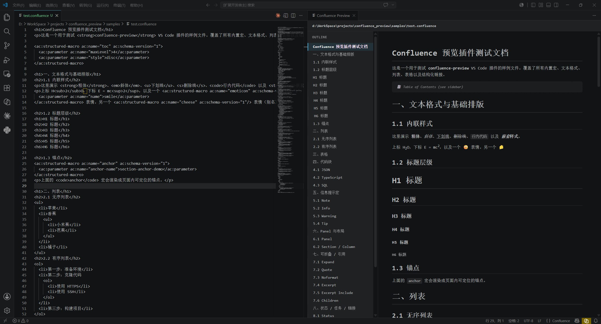
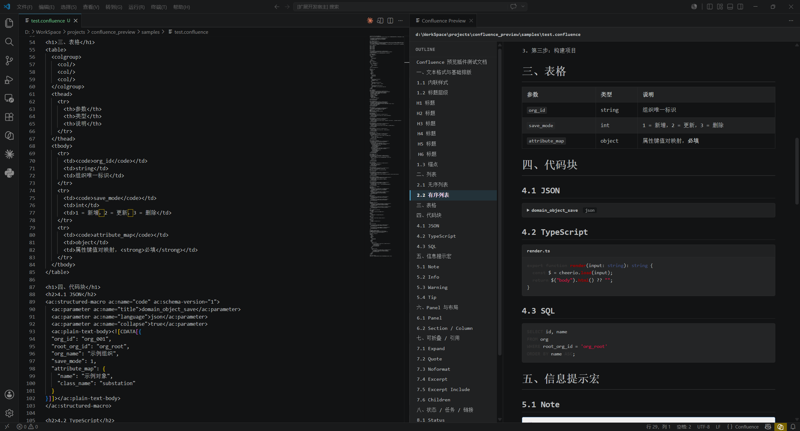
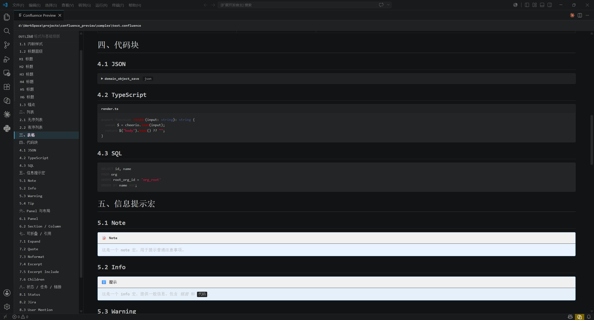
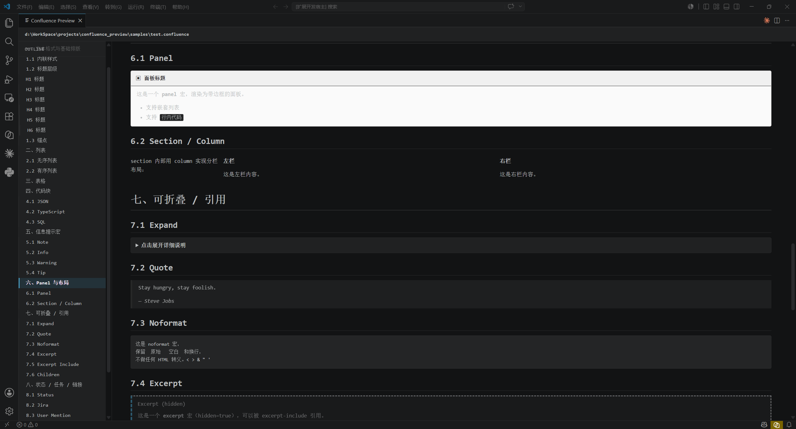
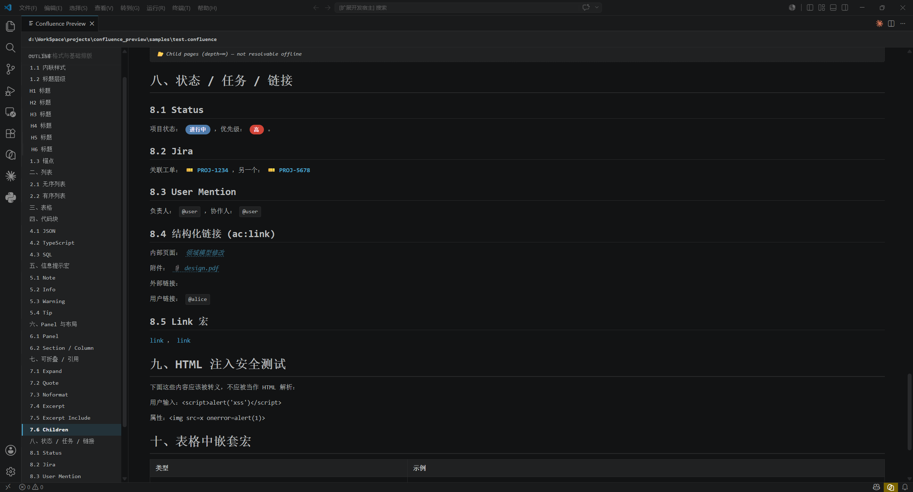

<div align="right">

**[English](./README.en.md)**

</div>

<div align="center">

<p align="center">
  
</p>

# Confluence Preview

在 VS Code 里预览 Confluence 存储格式（XHTML）。

[功能特性](#功能特性) · [快速开始](#快速开始) · [命令](#命令) · [设置](#设置) · [支持的元素](#支持的元素) · [常见问题](#常见问题)

[](./LICENSE)
[](https://code.visualstudio.com/)
[](https://www.typescriptlang.org/)
[](#为什么需要)
[]()
[](https://github.com/uwakeme/confluence_preview/actions/workflows/ci.yml)

纯客户端的 VS Code 扩展。打开 `.confluence` 文件，渲染页坐在源码旁边实时刷新。不连 Confluence，不发网络请求，不埋点。


左侧源码，右侧大纲加渲染页。

</div>

---

## 为什么需要

在 Confluence Source Editor 写文档，屏幕上一堆 `<ac:structured-macro>` 标签。想看效果只能粘回 Confluence 点 Preview，瞄一眼，再回去改。这个扩展把这一步砍了：VS Code 里打开文件，渲染页就在源码旁边，每敲一个键刷一次。不用 publish，不用反复贴。

解析器完全跑在本地，飞机、地铁、内网都能用。

---

## 功能特性

| | |
|---|---|
| **并排预览**：渲染页出现在编辑器旁边，编辑或保存时自动刷新，刷新后阅读位置和展开状态保持不变。 | **实时大纲侧边栏**：所有 `h1`–`h6` 汇总成可点击、可折叠的树形结构，跟随滚动位置，顶栏按钮随时收起。 |
| **完整宏支持**：`code`、`toc`、`panel`、`note` / `info` / `warning` / `tip`、`expand`、`status`、`jira`、`user-mention`、`link` / `pagelink`、`section` / `column`、`excerpt` / `excerpt-include`、`quote`、`noformat`、`anchor`、`children`、`emoticon` / `cheese`。未知宏降级为淡色提示框并给出警告。 | **代码块语法高亮**：JSON、TypeScript、SQL 等 `highlight.js` 支持的语言，跟随 VS Code 主题，支持行号与起始行号。 |
| **图片与附件**：`ac:image` 附件和相对路径 `` 解析为源码同目录的本地文件，支持尺寸、边框、说明文字；本地附件链接点击直接打开。 | **现代 Cloud 格式**：`ac:layout` 页面布局（等宽 / 侧边栏 / 三栏）、`ac:task-list` 任务清单、彩色文本、表格单元格高亮。 |
| **结构化链接解析**：`<ac:link>` 包裹的 `ri:page` / `ri:attachment` / `ri:url` / `ri:user` 都会渲染成对应的内联链接，支持自定义链接文字；配置 Confluence 基地址后内部页面链接变成真实链接。 | **主题自适应**：跟随 VS Code 的亮色 / 暗色 / 高对比度主题。 |
| **双向定位**：编辑器滚动时预览跟随到对应章节；双击预览标题跳回源码。 | **一键导出**：复制渲染后的 HTML、导出 Markdown，或导出自带样式与高亮的独立 HTML 文件（浏览器直接打开，自动跟随系统亮暗色）。 |
| **XSS 安全**：所有用户输入的文本先转义再渲染，样式参数经过白名单校验，`javascript:` 链接被中和。 | **窗口恢复**：VS Code 重载后预览窗口自动恢复，不用重新打开。 |

### 宏展示

| | |
|---|---|
| **代码块与表格**：可折叠面板、行号、JSON / TS / SQL 高亮。<br><br> | **彩色提示框**：`note`、`info`、`warning`、`tip`。<br><br> |
| **布局与折叠**：`panel`、`section` / `column`、`expand`、`quote`、`noformat`、`excerpt`。<br><br> | **状态、Jira、提及、链接、XSS 测试**：彩色标签、工单链接、@提及、页面 / 附件 / 用户 / 外链、转义后的 HTML。<br><br> |

---

## 快速开始

> clone 到出预览大概两分钟。

1. **装依赖 + 构建**
   ```sh
   npm install
   npm run build
   ```
2. **启动扩展**：VS Code 打开本目录，按 F5，会弹出一个新的扩展开发主机窗口。
3. **打开示例**：在新窗口里打开 `tests/test.confluence`（覆盖了所有支持的宏和现代格式），按 `Ctrl+Shift+V`（macOS `Cmd+Shift+V`），或 `Ctrl+Shift+P` 选 `Confluence: Open Preview`。

然后左编辑、右预览。

---

## 文件类型

以下文件名模式注册为 `confluence` 语言：

- `*.confluence`
- `*.cfl`
- `*.confluence-storage`

`.html` 文件默认不接管；打开设置 `confluence-previewer.enableForHtml` 后也能直接预览，不用重命名。

---

## 命令

| 命令 | 作用 |
|---|---|
| `Confluence: Open Preview` | 在编辑器旁边打开或聚焦预览面板（`Ctrl+Shift+V` / `Cmd+Shift+V`） |
| `Confluence: Refresh Preview` | 强制立即重新渲染（命令面板或预览打开时的编辑器标题栏按钮） |
| `Confluence: Copy Rendered HTML` | 复制渲染后的 HTML 到剪贴板 |
| `Confluence: Export to Markdown` | 将文档导出为 GFM 风格的 Markdown |
| `Confluence: Export Standalone HTML` | 导出单个自带样式与语法高亮的 HTML 文件，离线可开 |

---

## 设置

| 设置 | 默认 | 作用 |
|---|---|---|
| `confluence-previewer.baseUrl` | `""` | Confluence 基地址。设置后带空间 key 的内部页面链接解析为真实的 `/display/空间/标题` 链接 |
| `confluence-previewer.jiraBaseUrl` | `""` | Jira 基地址。没有 `baseurl` 参数的 `jira` 宏用它把工单号变成真实链接 |
| `confluence-previewer.localFiles` | `true` | 把附件链接、`ac:image`、相对路径 `` 解析为源码同目录下的本地文件 |
| `confluence-previewer.refreshDebounce` | `250` | 输入时预览刷新的防抖延迟（毫秒） |
| `confluence-previewer.outlineVisible` | `true` | 打开预览时显示大纲侧边栏（之后可用顶栏按钮切换，选择会被记住） |
| `confluence-previewer.enableForHtml` | `false` | 同时为普通 `.html` 文件提供预览 |

---

## 支持的元素

### 宏

| 宏 | 说明 |
|---|---|
| `code` | 支持 title、language、collapse、linenumbers、firstline；通过 `highlight.js` 高亮 |
| `toc` / `table-of-contents` | 在正文中渲染页内目录，支持 minLevel / maxLevel 与 flat / list 样式，另有完整侧边栏大纲 |
| `note` / `info` / `warning` / `tip` | 带图标的彩色提示框 |
| `panel` | 通过宏参数自定义标题、边框、颜色（参数经过安全校验） |
| `expand` | 可折叠块（`<details>`），刷新后保持展开状态 |
| `excerpt` / `excerpt-include` | 可复用的摘录块；同页引用直接展开内容，跨页引用显示占位符 |
| `quote` | 带样式的引用块 |
| `status` | 彩色标签（灰 / 绿 / 黄 / 红 / 蓝 / 紫），支持 subtle 样式 |
| `jira` | 工单链接（`baseurl` 参数或 `jiraBaseUrl` 设置；都没有时显示徽章） |
| `user-mention` | @user 标签，兼容 username / account-id / userKey 各版本参数 |
| `link` / `pagelink` | 链接宏，支持内联文本 |
| `section` / `column` | flex-row 布局，列宽参数经过校验 |
| `noformat` | 预格式化块（保留 CDATA 原样） |
| `anchor` | 页内锚点，兼容各版本参数名 |
| `children` | 占位（离线环境） |
| `emoticon` / `cheese` | 表情符号 |
| *未知宏* | 淡色降级框，显示宏名 + 内容，并在顶栏计数警告 |

### Confluence 元素

| 元素 | 说明 |
|---|---|
| `ac:image` | 附件图片（本地文件直接显示）、尺寸 / 边框 / 缩略图标记、`ac:caption` 说明文字；缺失或外部图片显示占位符 |
| `ac:task-list` / `ac:task` | 任务清单，完成状态渲染为勾选框 |
| `ac:layout` / `ac:layout-section` / `ac:layout-cell` | Confluence Cloud 页面布局：single / two_equal / three_equal / two_left_sidebar / two_right_sidebar / three_with_sidebars，窄屏自动换行 |

### 标准 HTML

所有标准 XHTML 元素：`h1`–`h6`、`p`、`strong` / `em` / `u` / `s`、`sub` / `sup`、行内 `code`、`pre`、`blockquote`、`ul` / `ol`（含 `start`）/ `li`、`a`、`img`、`table` / `thead` / `tbody` / `tfoot` / `colgroup` / `col` / `tr` / `th` / `td`（colspan / rowspan / scope / 单元格高亮）、`span`、`div`、`figure`、`figcaption`、`time`、`small`、`mark`、`cite`、`q`、`kbd`、`br`、`hr`。

颜色、背景、对齐等安全内联样式会保留显示；其余样式声明一律丢弃。

### 结构化链接

- `<ac:link><ri:page ri:content-title="…"/></ac:link>` → 蓝色内联链接（配置 `baseUrl` + 空间 key 后指向真实页面）
- `<ac:link><ri:attachment ri:filename="…"/></ac:link>` → 📎 附件链接（本地存在时点击直接打开）
- `<ac:link><ri:url ri:value="…"/></ac:link>` → 外链
- `<ac:link><ri:user ri:username="…"/></ac:link>` → @user 提及
- `ac:plain-text-link-body` / `ac:link-body` 自定义链接文字（纯文本或富文本）
- 文本中直接使用的 `<ri:page>` 等也会被解析

---

## 常见问题

**需要 Confluence 账号吗？**
不需要。纯本地解析器，不连任何东西，源码不出你的机器。

**离线 / 内网能用吗？**
能。没有网络请求，没有埋点，没有自动更新 ping，过得了等保和隔离网。

**内部页面 / 附件链接会跳吗？**
页面链接：设置 `confluence-previewer.baseUrl` 后，带空间 key 的 `ri:page` 会解析成真实 Confluence 链接；没设置时渲染成带标题的占位符。附件链接：文件放在源码同目录就能点击打开，否则显示占位符。

**图片为什么不显示？**
外部图片永远不加载（离线承诺 + CSP）。把附件文件放到源码同目录，`ac:image` 和相对路径 `` 就会直接显示；找不到文件时显示带文件名和尺寸的占位符。

**预览不刷新怎么办？**
命令面板里跑 `Confluence: Refresh Preview`，或点编辑器标题栏的刷新按钮。默认是 250ms 防抖（`refreshDebounce` 可调），大段粘贴后手动按一下有帮助。

**能在预览里直接编辑吗？**
不能，预览是只读的。配合 VS Code 正常编辑 `.confluence` 文件就行，Source Control 一样能用。

**想加自定义宏怎么办？**
可以，看下面的「开发者」一节。每个宏就是 `src/parser/macros/` 下的一个 TypeScript 文件，在 `registry.ts` 里登记一下就完事。

---

## 局限

- **无网络请求。** 没配置 `baseUrl` 时，内部页面链接渲染成带标题的占位符；跨页 `excerpt-include` 无法解析，显示占位符并给出警告。
- **外部图片不加载。** 外部 `` 和 `ri:url` 图片显示为占位符，以满足 webview 的 CSP 策略并保持纯离线运行。本地附件图片不受影响。
- **只读预览。** 编辑仍需在 Confluence 自带的 Source Editor 中进行。
- **Markdown 导出尽力而为。** 宏转成最接近的 Markdown 等价物（表格、任务列表、代码围栏、折叠块等）；不保证可逆。

---

<details>
<summary><h2>开发者</h2></summary>

### 架构

```
┌─────────────────────┐                ┌──────────────────────┐
│  Confluence 源码    │   parse        │  ParseResult         │
│  (XHTML + ac:/ri:)  │ ─────────────► │   - html             │
│                     │                │   - outline tree     │
└─────────────────────┘                │   - macros seen      │
                                       │   - warnings         │
                                       └─────────┬────────────┘
                                                 │ postMessage
                                                 ▼
                                       ┌──────────────────────┐
                                       │  Webview (CSP-safe)  │
                                       │   - style.css        │
                                       │   - script.js        │
                                       │   - highlight.min.js │
                                       └──────────────────────┘
```

#### 预处理：CDATA 与自闭合标签

Confluence 源码用 XML CDATA 块（`<![CDATA[ ... ]]>`）原样保留代码。浏览器 HTML 解析器把 CDATA 当成注释处理，会破坏 code 宏的 body。我们在解析前把每个 CDATA 块替换成 `<cf-cdata data-b64="…">` 占位符，然后在宏渲染器里把 base64 解码回原始文本。

存储格式是 XHTML，`<ri:page …/>` 这类自定义标签是自闭合的；HTML 解析器会忽略斜杠让它们吞掉后续兄弟节点。解析前统一把它们展开成显式的开闭标签对（在 CDATA 替换之后执行，代码样本不受影响）。

#### 宏路由

`src/parser/macros/registry.ts` 把每个支持的宏名映射到一个渲染函数。每个渲染函数接收：

- 已解析的 cheerio 节点
- 共享的 `RenderContext`（大纲、警告、TOC / 摘录注册表、宿主能力回调）
- 解析后的 `<ac:parameter>` 字典（只读直接子级，嵌套宏互不串扰）
- 渲染好的 rich-text-body HTML（或 `""`）
- 原始 CDATA 文本（或 `""`）

未知宏名走 `fallbackMacro`，显示一个带宏名和正文的淡色框并记录警告。`toc` 与 `excerpt-include` 先留下标记，等整棵文档走完、大纲 / 摘录注册表齐全后在第二遍渲染里回填。

### 项目结构

```
confluence_preview/
├── package.json              # 扩展清单 + 脚本
├── package.nls.json          # 命令 / 设置文案（英文）
├── package.nls.zh-cn.json    # 命令 / 设置文案（中文）
├── tsconfig.json
├── esbuild.config.mjs        # 打包配置（同时复制 media/）
├── .github/workflows/ci.yml  # CI：类型检查 + 构建 + 测试，tag 打包 VSIX
├── .vscode/launch.json       # F5 调试配置
├── src/
│   ├── extension.ts          # 扩展入口，命令 / serializer / 滚动事件注册
│   ├── previewPanel.ts       # 预览 webview 生命周期 + 命令 + 独立 HTML 导出
│   ├── links.ts              # 纯函数 URL 工具（href 校验 / 页面 / Jira 链接）
│   ├── parser/
│   │   ├── index.ts          # 公开的 parseConfluence() + 第二遍回填
│   │   ├── source.ts         # CDATA / 自闭合预处理、cheerio 加载、参数读取
│   │   ├── elements.ts       # 标准 HTML 递归 + ac:image / task / layout
│   │   ├── outline.ts        # h1–h6 大纲树 + 源码偏移定位
│   │   ├── markdown.ts       # GFM Markdown 导出
│   │   ├── sanitize.ts       # 转义 / slug / CSS 白名单校验
│   │   ├── types.ts
│   │   └── macros/           # 每个宏一个渲染器
│   └── media/                # webview 资源（css, js, hljs）
├── image/                    # README 截图
└── tests/
    ├── *.test.mjs            # Node 测试运行器单测（安全 / 宏 / 元素 / 大纲 / 导出）
    └── test.confluence       # 覆盖所有宏与现代格式的完整示例
```

### 开发命令

| 命令 | 作用 |
|---|---|
| `npm install` | 安装依赖 |
| `npm run build` | 打包 `src/extension.ts` → `dist/extension.js` |
| `npm run watch` | 监听变化自动重建（F5 调试用） |
| `npm test` | 运行 Node 测试（`pretest` 会先把解析器打包成 `tests/parser.bundle.mjs`） |
| `npx tsc --noEmit` | 类型检查 |

### 加一个新宏

1. 在 `src/parser/macros/<name>.ts` 里写一个 `render<Name>Macro` 函数。
2. 在 `src/parser/macros/registry.ts` 的 `REGISTRY` 里登记。
3. 在 `tests/<name>.test.mjs` 加测试，断言生成的 HTML。
4. 跑 `npm test` + `npx tsc --noEmit`，再打开 `tests/test.confluence` 肉眼对一下渲染结果。

</details>

---

## 许可证

MIT，见 [LICENSE](./LICENSE)。

## 致谢

- HTML 解析：[cheerio](https://cheerio.js.org/)
- 语法高亮：[highlight.js](https://highlightjs.org/)
- 适配 VS Code ≥ 1.75